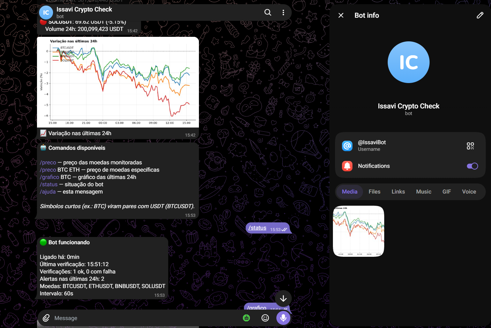

# Issavi Crypto Check

🇧🇷 [Leia em português](README.PT.md)

Python bot that monitors the crypto market through the **Binance public API**
and sends alerts, summaries and charts via **Telegram**.

> Read-only access to public market data: no API key, and no buy, sell or
> account functions of any kind.

<p align="center">
  
</p>

## Features

- **Price change alert:** notifies when the 24h change exceeds ±3% (configurable).
- **Price target alert:** notifies when the price crosses a set value, upward or downward.
- **Cooldown:** the same alert is not repeated for 30 minutes, even after a restart.
- **Daily summary:** price, change and volume for each coin, with a 24h comparison chart.
- **Telegram commands:** `/preco` (price), `/grafico` (chart), `/status` and `/ajuda` (help), answered instantly and only for the authorized chat.
- **SQLite history:** prices and sent alerts are stored locally.

> The bot's messages and commands are in Portuguese.

## Tech stack

| | |
|---|---|
| **Python 3** | `requests`, `python-dotenv`, `logging`, `sqlite3`, `argparse` |
| **Binance public API** | `/api/v3/ticker/24hr` and `/api/v3/klines` |
| **Telegram Bot API** | `sendMessage`, `sendPhoto` and `getUpdates` (long polling) |
| **matplotlib** | Charts rendered in memory and sent as images |
| **pytest** | 43 tests with simulated data, no network access |

## Technical highlights

- **Resilience:** every request has a timeout, and failed requests are retried with exponential backoff (1s, 2s, 4s…). The bot honors Binance's `Retry-After` (HTTP 429/418) and does not retry 4xx errors, since retrying won't fix them. A temporary failure never stops the bot.
- **Efficient API usage:** all coins are fetched in a single request, at a configurable interval (60s by default).
- **Commands without threads:** the time between checks is spent listening to Telegram, so the bot replies instantly with a single flow of execution.
- **Testable logic:** alert rules never touch the network or the database, and the current time is passed as a parameter so tests can simulate time passing.
- **Security:** the token and chat_id live in `.env` (kept out of Git), the token is never logged, the bot only answers the configured chat, and SQL uses parameterized queries.

## Getting started

```powershell
python -m venv venv
venv\Scripts\activate
pip install -r requirements.txt
copy .env.example .env      # fill in TELEGRAM_BOT_TOKEN and TELEGRAM_CHAT_ID
python main.py              # runs continuously
```

| Command | Purpose |
|---|---|
| `python main.py --once` | Runs a single check and exits |
| `python main.py --test-summary` | Sends the daily summary now |
| `python -m pytest` | Runs the tests |

Coins, thresholds, price targets and the summary time are set in
[`config.json`](config.json). If `api.binance.com` is blocked on your network,
set `base_url` to `https://data-api.binance.vision`.

**Telegram:** create the bot with [@BotFather](https://t.me/BotFather), send it
a message, then get the `chat.id` from
`https://api.telegram.org/bot<TOKEN>/getUpdates`. Be careful not to copy the
`update_id` instead.

## Project structure

```
main.py            main loop, daily summary, logging
binance_client.py  Binance public API (with retry)
alerts.py          alert rules and cooldown
telegram_bot.py    messages, photos and command polling
commands.py        /preco, /grafico, /status, /ajuda
storage.py         SQLite history
charts.py          matplotlib charts
tests/             pytest tests
```
